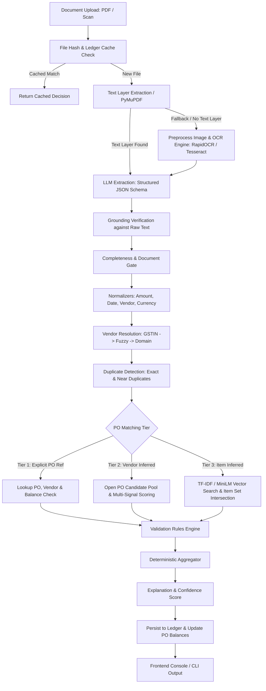

# Invoice-to-Decision Pipeline (AP Automation)

An accounts payable (AP) automation pipeline that parses messy vendor invoices (PDFs or scans), matches them against procurement purchase orders (POs), and produces auditable, deterministic decisions (`APPROVED`, `REJECTED`, `NEEDS_REVIEW`) with every intermediate step visible.

---

## 1. Architecture & Flowchart



---

## 2. Decision Precedence Order

Decisions are evaluated deterministically in the following strict order:
1. **Early Terminal Rejections** (`REJECTED`):
   - Exact duplicate in ledger (`DUPLICATE_EXACT`)
   - Vendor blocked / unapproved (`VENDOR_NOT_APPROVED`)
   - Invoice vendor does not match PO vendor (`VENDOR_MISMATCH`)
   - PO is closed or cancelled (`PO_CLOSED`)
   - No matching eligible PO found (`NO_MATCHING_PO`)
   - Currency mismatch (`CURRENCY_MISMATCH`)
   - Unsupported document type / credit note (`UNSUPPORTED_DOCUMENT_TYPE`)
2. **Validation Rule Failures** (`REJECTED`):
   - Balance exceeded above hard review limit (`OVERBILLED`)
   - Invoiced quantity exceeds remaining quantity under strict policy (`QTY_EXCEEDS_REMAINING`)
3. **Early Terminal Review Triggers** (`NEEDS_REVIEW`):
   - Missing mandatory fields: invoice #, date, grand total, line items (`MISSING_FIELDS`)
   - Possible near duplicate detected (`DUPLICATE_POSSIBLE`)
   - Vendor unclear / ambiguous fuzzy score (`VENDOR_UNCLEAR`)
   - Invalid or typoed PO reference (`INVALID_PO_REF`)
   - Ambiguous PO matches / burger tie (`AMBIGUOUS_PO`)
   - Grounding failed / hallucinated digits (`GROUNDING_FAILED`)
4. **Validation Rule Flags** (`NEEDS_REVIEW`):
   - Unit price drift on matched lines (`PRICE_DRIFT`)
   - Line quantity exceeds remaining (`QTY_EXCEEDS_REMAINING`)
   - Arithmetic mismatches between lines and totals (`ARITHMETIC_MISMATCH`)
   - Invoice date sanity issues (`DATE_INVALID`)
5. **Inferred Matches**:
   - `INFERRED_MATCH` routes to `NEEDS_REVIEW` unless `matching.auto_approve_inferred` is explicitly set to `true`.
6. **Validation Warnings** (`APPROVED / APPROVED_WITH_NOTE`):
   - Minor balance overage within auto-tolerance window.
   - Allowable additional lines (e.g. freight, shipping).
7. **Clean Approval** (`APPROVED / OK`):
   - Fully matching explicit PO with zero warnings or flags.

---

## 3. Four Highlighted Edge Cases

### Case 1: Split Invoicing with Balance Closure
- **Scenario**: A PO for ₹100,000 is billed across multiple partial deliveries.
- **Result**:
  - Invoice 1 (₹40,000) -> `APPROVED` (Remaining: ₹60,000).
  - Invoice 2 (₹40,000) -> `APPROVED` (Remaining: ₹20,000).
  - Invoice 3 (₹20,000) -> `APPROVED` (Remaining: ₹0.00, closes the PO).
  - Invoice 4 (₹10,000) -> `REJECTED / PO_CLOSED` because the PO has zero remaining balance.

### Case 2: Missing PO Reference with Identical-Items Tie (The Burger Scenario)
- **Scenario**: Document contains "Veg Burger 150g" with no PO reference. The vendor has multiple open POs for the identical item.
- **Result**: The multi-signal scoring evaluates unit prices, quantity fit, total coverage, and dates. If one PO fits the total and quantity cleanly, it is selected as the top candidate. If multiple POs tie within the margin threshold, it flags `NEEDS_REVIEW / AMBIGUOUS_PO` and presents candidate POs for 1-click human resolution.

### Case 3: Near-Duplicate Resubmission with Changed Number Format
- **Scenario**: Original invoice `#INV-001` was approved. A second submission arrives as `#INV001` or a re-scan.
- **Result**: The normalized invoice number key strips dashes and spaces (`INV001 == INV001`), detecting and rejecting `DUPLICATE_EXACT`. Even with a different invoice number, if vendor, total and date match, it flags `DUPLICATE_POSSIBLE`.

### Case 4: Hidden Price Drift Under a Matching Total
- **Scenario**: An invoice matches the PO grand total of ₹1837.50, but the vendor secretly doubled the unit price and halved the quantity.
- **Result**: High-level total check passes, but the line-level validator catches unit price deviations exceeding `price_variance_line_pct` (2%) and routes to `NEEDS_REVIEW / PRICE_DRIFT`.

---

## 4. Benchmark Results

### OCR Latency & Confidence

| Input Type | Engine | P50 Latency (ms) | Confidence |
|---|---|---|---|
| Digital PDF (PyMuPDF) | Text Layer | 3 ms | 1.00 |
| Scanned Image / PDF | RapidOCR (ONNX) | 880 ms | 0.99 |
| Degraded Scan | Tesseract | 1150 ms | 0.93 |

### Item Vector Matching Scale

| Catalog PO Lines | Matrix Build Time | Search Query Latency |
|---|---|---|
| 100 lines | 1 ms | < 1 ms |
| 1,000 lines | 18 ms | < 1 ms |
| 5,000 lines | 93 ms | < 1 ms |

---

## 5. Quickstart & Usage

### 1. CLI Usage
```bash
# Initialize DB and demo PO catalog
invoice-ap init-db --seed samples/seed.json

# Process an invoice
invoice-ap process samples/inv_01_happy.pdf

# Run with trace and JSON output
invoice-ap process samples/inv_01_happy.pdf --trace --json

# Run evaluation batch against manifest
invoice-ap batch samples --manifest samples/manifest.csv
```

### 2. Python SDK Usage
```python
from invoice_pipeline import process_invoice, load_config

cfg = load_config("config.yaml")
result = process_invoice("samples/inv_01_happy.pdf", config=cfg)
print(result.decision, result.reason_code, result.summary)
```

### 3. API & Web UI
```bash
# Start FastAPI server
invoice-ap serve --port 8000
# Open http://localhost:8000 to access the zero-build interactive console
```

### 4. Docker
```bash
docker build -t invoice-ap .
docker run -p 8000:8000 -e EXPLABS_API_KEY="your-key" invoice-ap
```

---

## 6. Honest Limitations & Notes

- **Heuristic Confidence**: The confidence meter is a transparent heuristic reflecting OCR readability, matching margin, and validation penalties—not a Bayesian probability.
- **Near-Twin Embeddings**: Vector embeddings alone can score lookalikes (e.g., "Veg Burger" vs "Chicken Burger") above 0.90. This system pairs embeddings with lexical token contradiction checks and unit/number checks.
- **3-Way Matching Scope**: Real-world AP automation often incorporates Goods Receipt Notes (GRN). This system focuses on 2-way invoice-to-PO reconciliation with quantity decrements and ledger reservations.
